# SnipNation

<picture>
  <source media="(prefers-color-scheme: dark)" srcset="assets/branding/readme-banner-dark.svg">
  <source media="(prefers-color-scheme: light)" srcset="assets/branding/readme-banner-light.svg">
  
</picture>

[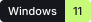](https://github.com/PhilipU/SnipNation/releases)
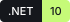
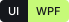
[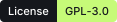](LICENSE)
[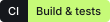](https://github.com/PhilipU/SnipNation/actions/workflows/ci.yml)

SnipNation is a screenshot tool for Windows 11. Capture and annotate screenshots for step-by-step guides and quick explanations for your team.

## Quick start

Get the Windows installer from [Releases](https://github.com/PhilipU/SnipNation/releases).

1. Press **Print Screen**, or click the SnipNation icon in the system tray and choose **Screenshot**.
2. Click an outlined window or drag to capture an area. Press **Esc** to cancel.
3. Paste the screenshot with **Ctrl+V**, or double-click it in the tray gallery to edit it. Select an annotation tool on the left and choose one of its six presets.
4. Right-click an annotation and choose **Settings** to change its style. Select **Save as default for this preset** to replace the preset for future annotations.
5. To crop, choose **Crop image** at the top, drag over the area to keep, and press **Enter**.
6. Press **Ctrl+S** to save your edits. Use **Ctrl+C** to copy the edited image or **Export** to save it as PNG or JPEG.

If **Print Screen** is already in use, right-click the tray icon and choose **Ctrl+Shift+Print Screen** under **Keyboard shortcuts**.

## Screenshots

**On the Microsoft Windows 11 desktop**

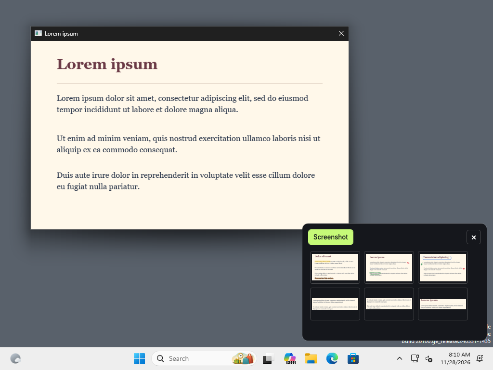

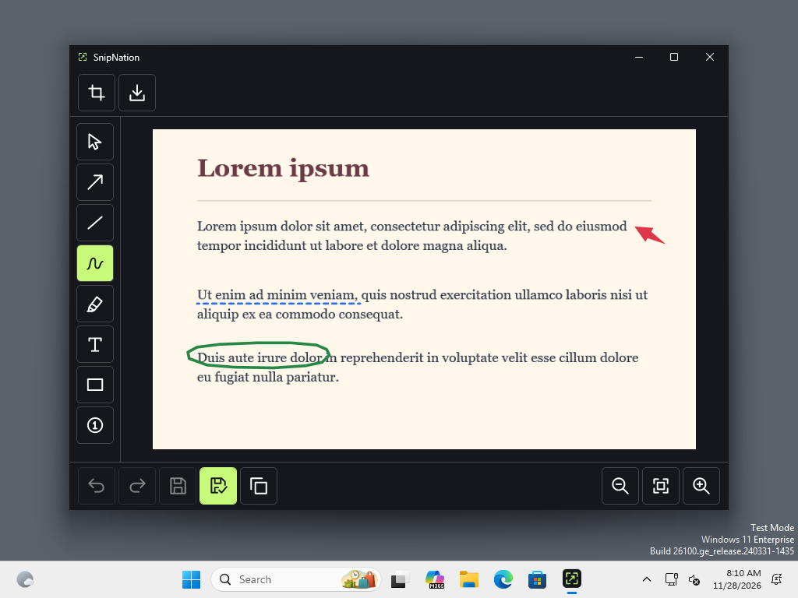

  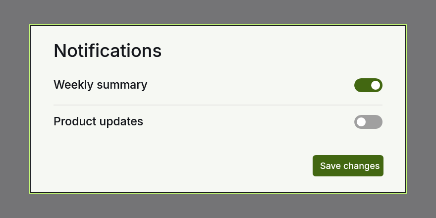
  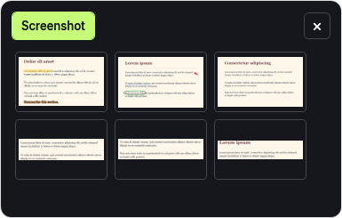

**Arrows, lines, and freehand**

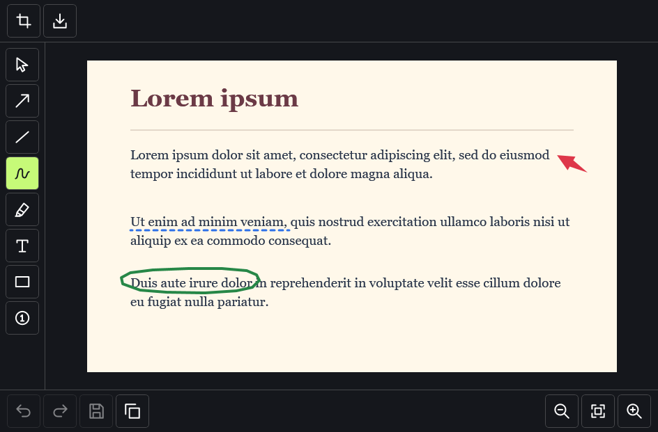

**Highlights and text**

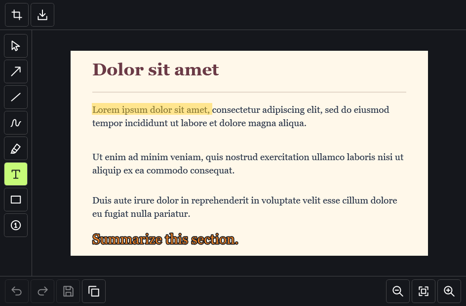

**Tool presets**

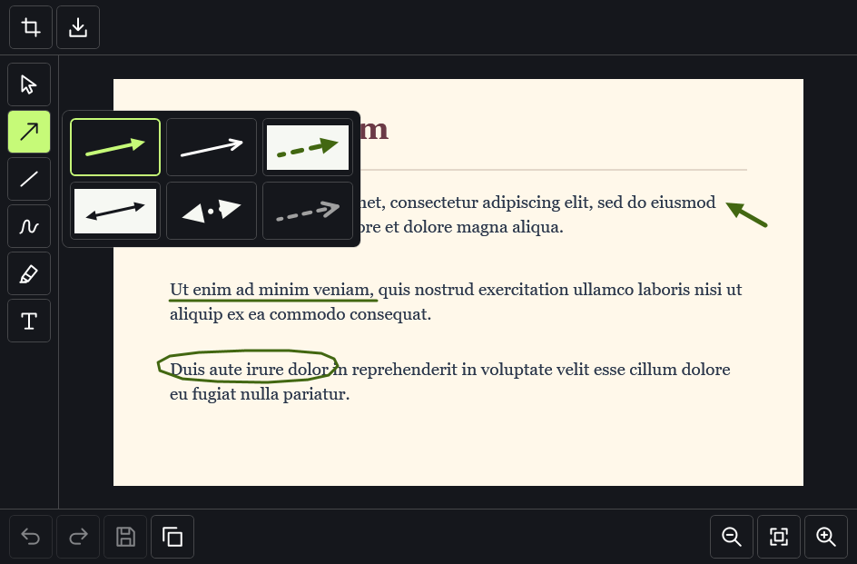

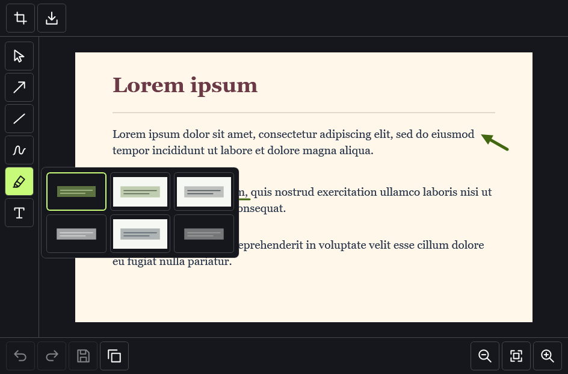

[Contributing](CONTRIBUTING.md) · [Security policy](SECURITY.md)
